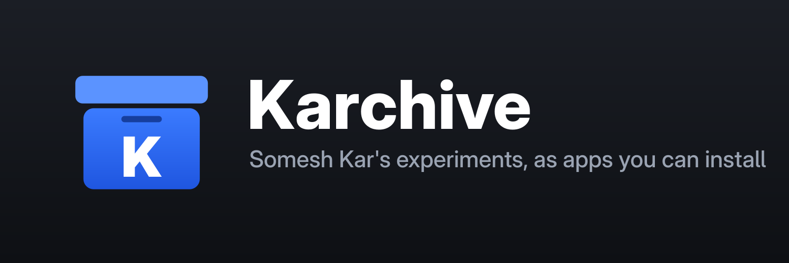

# Karchive

A SideStore / LiveContainer source for my experiments that come with iOS apps.

This repo is private. The source is served by GitHub Pages from an unlisted
path, set in `site.env`; anyone with that URL can fetch the source and its IPAs,
nobody without it can find them.

- `source.json`: the source. Every download URL points under `SITE_URL`.
- `ipas/`: the IPAs, kept out of git. Each one is also attached to a private
  release, which `publish-site.sh` falls back to.
- `publish-site.sh`: builds the site and force-pushes it to `gh-pages` as one
  commit.

Vispr publishes here with `apps/vispr-ios/publish-sidestore.sh` in the vispr repo.
